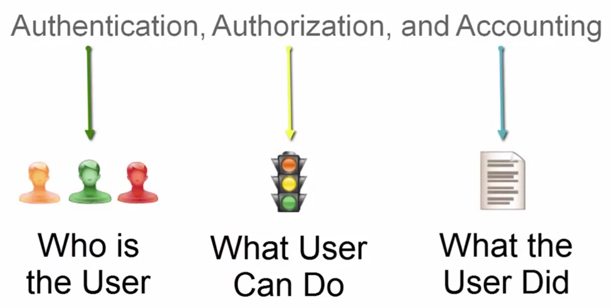

# AAA Framework: Authentication, Authorization, and Accounting

## 1. Overview of AAA
In network security and access management, the **AAA framework** serves as the foundational model for controlling user access, enforcing security policies, and tracking user activities within an organization's infrastructure. 

As a security analyst, understanding AAA is crucial for designing secure networks, implementing firewalls, and managing server logs.

---

## 2. The Three Pillars of AAA

### A. Authentication (التحقق من الهوية) - "Who is the User"
* **Definition:** The process of verifying the identity of a user, device, or system trying to access the network.
* **How it works:** The system checks user credentials (such as passwords, multi-factor authentication (MFA), biometrics, or digital certificates) against a database.
* **Analogy:** Showing your ID card or passport at a security checkpoint.

### B. Authorization (التفويض والصلاحيات) - "What User Can Do"
* **Definition:** Determining what resources and operations a verified user is allowed to access after successful authentication.
* **How it works:** Based on the user's role and security policies (like the access control models we discussed: MAC, DAC, RBAC), the system grants or restricts permissions (Read, Write, Execute).
* **Analogy:** Having a key that opens specific doors in a building, while other doors remain locked.

### C. Accounting (المحاسبة وتسجيل النشاطات) - "What the User Did"
* **Definition:** Tracking and logging user activities and resource consumption within the system.
* **How it works:** Systems record login/logout times, commands executed, data accessed, and network bandwidth used. This data is vital for security audits, forensic investigations, and SIEM monitoring (such as Wazuh).
* **Analogy:** A security guard logging every entry, exit, and action taken by visitors in a secure logbook.

---

## 3. Why AAA Matters for Security Analysts
* **Centralized Control:** Simplifies user management across enterprise networks using protocols like **RADIUS** and **TACACS+**.
* **Incident Response & Forensics:** When a security breach occurs, Accounting logs provide the exact timeline and actions of the attacker.
* **Defense in Depth:** Combines identification, permission enforcement, and tracking to minimize unauthorized access risks.
